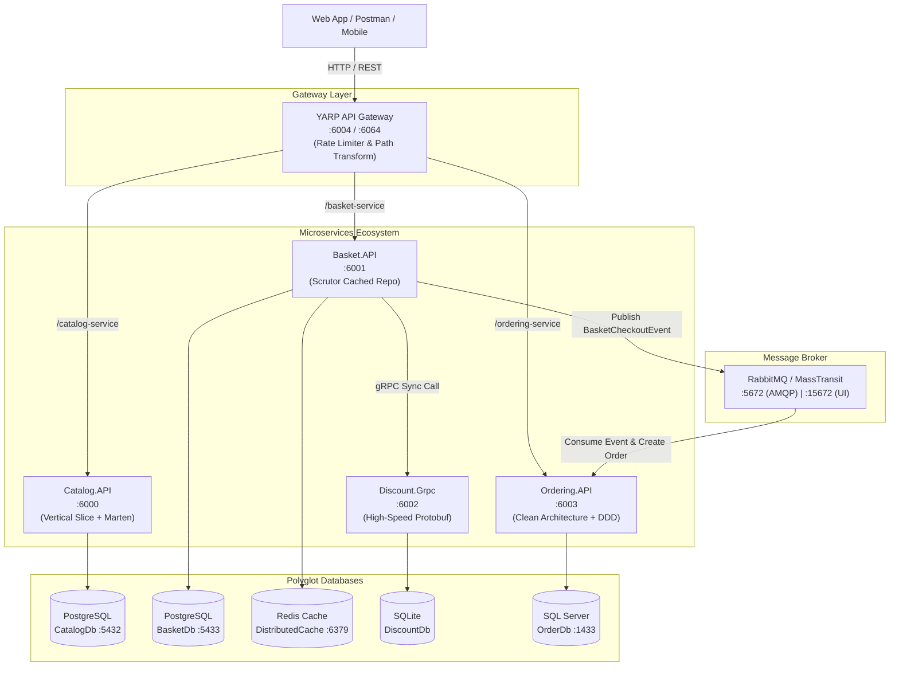
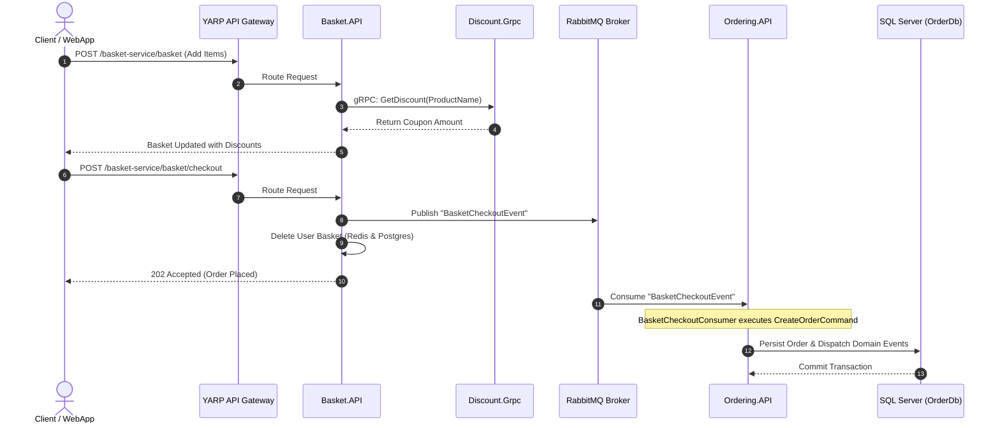

# 🛒 EShop Distributed Microservices Platform

[](https://dotnet.microsoft.com/)
[](https://www.docker.com/)
[](https://www.rabbitmq.com/)
[](https://www.postgresql.org/)
[](https://redis.io/)
[](https://www.microsoft.com/sql-server)
[](https://grpc.io/)
[](./LICENSE)

A production-grade, event-driven e-commerce platform built with **.NET 8**, showcasing modern **Microservices Architecture**, **Clean Architecture**, **Domain-Driven Design (DDD)**, **Vertical Slice Architecture**, **CQRS with MediatR**, **gRPC communication**, **YARP API Gateway**, and **Polyglot Persistence**.

---

## 📑 Table of Contents

- [System Architecture](#-system-architecture)
- [Key Features](#-key-features)
- [Microservices Overview](#-microservices-overview)
- [Design Patterns & Architectural Principles](#-design-patterns--architectural-principles)
- [Polyglot Persistence](#-polyglot-persistence)
- [Communication & Messaging Flow](#-communication--messaging-flow)
- [Port Mappings & Service Endpoints](#-port-mappings--service-endpoints)
- [Getting Started](#-getting-started)
  - [Prerequisites](#prerequisites)
  - [Run with Docker Compose](#run-with-docker-compose)
  - [Run Locally in Visual Studio](#run-locally-in-visual-studio)
- [API Testing & Postman](#-api-testing--postman)
- [Cross-Cutting Concerns](#-cross-cutting-concerns)
- [Repository Structure](#-repository-structure)
- [License](#-license)

---

## 🏛 System Architecture

The following diagram illustrates the high-level architecture, inter-service communications, databases, and message broker:



---

## ✨ Key Features

- **Microservices Architecture**: Autonomous, independently deployable services with isolated business domains and decoupled databases.
- **Clean Architecture & Domain-Driven Design (DDD)**: Rich domain models, entities, value objects, domain events, aggregates, and repository abstractions in the Ordering service.
- **Vertical Slice Architecture**: Feature-folder organization in the Catalog and Basket services for maximum cohesion.
- **CQRS (Command Query Responsibility Segregation)**: Implemented using **MediatR** to split read and write pipelines cleanly.
- **High-Performance Inter-Service Communication**:
  - **Synchronous**: Direct binary **gRPC** calls between `Basket.API` and `Discount.Grpc`.
  - **Asynchronous**: Loosely-coupled event-driven messaging using **RabbitMQ** with **MassTransit**.
- **YARP API Gateway (Reverse Proxy)**: Centralized entry point providing routing, path rewriting, and rate limiting.
- **Advanced Caching**: Redis distributed cache wrapped around PostgreSQL storage using the **Decorator Pattern** via **Scrutor**.
- **Cross-Cutting Pipeline Behaviors**: MediatR pipeline behaviors for centralized logging, performance tracking, and FluentValidation.
- **Global Problem Details Exception Handling**: Custom exception handler middleware adhering to RFC 7807 specs.
- **Health Checks & Monitoring**: Built-in health checks for databases, caches, and UI clients.
- **Full Containerization**: Multi-stage Dockerfiles and comprehensive `docker-compose` setups.

---

## 🧩 Microservices Overview

### 1. 📦 Catalog Microservice (`Catalog.API`)
- **Pattern**: Vertical Slice Architecture with Feature Folders (`Products/CreateProduct`, `Products/GetProducts`, etc.).
- **Stack**: .NET 8, Carter (Minimal APIs), MediatR, FluentValidation, Marten, PostgreSQL.
- **Data Store**: **PostgreSQL** using **Marten** as a transactional document store.
- **Features**:
  - Full Product CRUD with category filters and pagination.
  - Automatic database initialization and seeding on startup (`CatalogIntialData`).
  - Health checks verifying PostgreSQL connectivity.

### 2. 🧺 Basket Microservice (`Basket.API`)
- **Pattern**: CQRS + Decorator Pattern.
- **Stack**: .NET 8, Carter, MediatR, Scrutor, Marten, Redis, gRPC Client, MassTransit.
- **Data Store**: **PostgreSQL** (persistent cart) + **Redis** (distributed cache).
- **Features**:
  - High-speed shopping cart management.
  - **Decorator Pattern via Scrutor**: `CachedBasketRepository` wraps `BasketRepository` to provide transparent caching in Redis.
  - **gRPC Integration**: Calls `Discount.Grpc` to calculate coupon discounts and adjust final prices in real time.
  - **Event Publishing**: Publishes `BasketCheckoutEvent` to RabbitMQ upon user checkout and flushes the basket.

### 3. 🏷️ Discount Microservice (`Discount.Grpc`)
- **Pattern**: gRPC Service.
- **Stack**: .NET 8, gRPC (`discount.proto`), Entity Framework Core, SQLite, Mapster.
- **Data Store**: **SQLite** (`discountdb`).
- **Features**:
  - High-performance RPC methods: `GetDiscount`, `CreateDiscount`, `UpdateDiscount`, `DeleteDiscount`.
  - Automatic EF Core database migration and coupon seeding (`MigrationExtensions`).

### 4. 📋 Ordering Microservice (`Ordering.API`)
- **Pattern**: Clean Architecture + Domain-Driven Design (DDD).
- **Project Structure**:
  - `Ordering.Domain`: Entities (`Order`, `OrderItem`, `Customer`, `Product`), Value Objects (`Address`, `Payment`, `OrderName`, strongly typed IDs), Domain Events (`OrderCreatedEvent`, `OrderUpdatedEvent`), Enums (`OrderStatus`).
  - `Ordering.Application`: CQRS Commands/Queries, MediatR handlers, FluentValidation, DTOs, and event consumers (`BasketCheckoutConsumer`).
  - `Ordering.Infrastructure`: EF Core with **SQL Server**, `ApplicationDbContext`, schema configurations, auto-migrations, and interceptors:
    - `AuditableEntityInterceptor`: Automatically tracks `CreatedAt`, `CreatedBy`, `LastModified`, `LastModifiedBy`.
    - `DispatchDomainEventsInterceptor`: Automatically dispatches domain events via MediatR during `SaveChangesAsync`.
  - `Ordering.API`: Exposes endpoints via Carter Minimal APIs.
- **Features**:
  - Consumes `BasketCheckoutEvent` from RabbitMQ and executes `CreateOrderCommand`.
  - Rich domain validations and domain event auditing.
  - Paginated queries, customer-based order search, and order lifecycle management.

### 5. 🌐 API Gateway (`YarbApiGateway`)
- **Stack**: Microsoft YARP (Yet Another Reverse Proxy), ASP.NET Core 8 Rate Limiting.
- **Routing Rules**:
  - `/catalog-service/**` $\rightarrow$ `catalog.api:8080`
  - `/basket-service/**` $\rightarrow$ `basket.api:8080`
  - `/ordering-service/**` $\rightarrow$ `ordering.api:8080` (Enforced with a fixed-window rate limiter: 5 requests / 10s).

### 6. 🧱 Shared Building Blocks
- **`BuildingBlocks`**:
  - CQRS interfaces: `ICommand`, `ICommandHandler`, `IQuery`, `IQueryHandler`.
  - MediatR Behaviors: `LoggingBehavior` (logs requests and flags operations exceeding 3 seconds), `ValidatorBehavior` (executes FluentValidation rules).
  - Global Exception Handler (`CustomExceptionHandler` generating RFC 7807 Problem Details).
  - Reusable Pagination primitives: `PaginationRequest`, `PaginatedResult<T>`.
- **`BuildingBlocks.Messaging`**:
  - Abstractions: `IntegrationEvent`, `BasketCheckoutEvent`.
  - MassTransit extension methods (`AddMessageBroker`) for standardized RabbitMQ configuration.

---

## 📐 Design Patterns & Architectural Principles

| Pattern / Principle | Implementation in Project |
| :--- | :--- |
| **Clean Architecture** | Decoupled Domain, Application, Infrastructure, and API layers in `Ordering`. |
| **Domain-Driven Design (DDD)** | Aggregate Roots, Entities, Value Objects, Domain Events, and Specifications. |
| **Vertical Slice Architecture** | Feature-based folders in `Catalog.API` encapsulating command, endpoint, and handler. |
| **CQRS** | Separation of write commands (`ICommand`) and read queries (`IQuery`) via MediatR. |
| **Decorator Pattern** | Redis cache layer `CachedBasketRepository` decorating Marten `BasketRepository` via Scrutor. |
| **Publish / Subscribe** | Asynchronous inter-service communication through RabbitMQ and MassTransit. |
| **API Gateway / Reverse Proxy** | Unified entry point and protocol abstraction using YARP. |
| **Pipeline Behaviors** | Intercepting MediatR pipeline for automated cross-cutting concerns (Validation, Logging). |
| **EF Core Interceptors** | Auto-auditing dates and automatic dispatching of domain events on persistence. |
| **Polyglot Persistence** | Choosing the best database engine suited for each microservice's domain model. |

---

## 💾 Polyglot Persistence

| Microservice | Database Engine | Technology / ORM | Data Model |
| :--- | :--- | :--- | :--- |
| **Catalog.API** | **PostgreSQL** (Port 5432) | Marten | Document Store (JSONB) |
| **Basket.API** | **PostgreSQL** (Port 5433) + **Redis** (Port 6379) | Marten + StackExchange.Redis | Document + In-Memory Distributed Cache |
| **Discount.Grpc** | **SQLite** | Entity Framework Core | Relational (Lightweight Embedded) |
| **Ordering.API** | **Microsoft SQL Server** (Port 1433) | Entity Framework Core | Relational (Enterprise DDD Schema) |

---

## ⚡ Communication & Messaging Flow

### 🛒 Checkout to Order Processing Flow



---

## 🔌 Port Mappings & Service Endpoints

| Service / Container | Internal Port | Host Port (HTTP) | Host Port (HTTPS) | Description |
| :--- | :--- | :--- | :--- | :--- |
| **YARP API Gateway** | `8080` / `8081` | `6004` | `6064` | Main Public Gateway |
| **Catalog.API** | `8080` / `8081` | `6000` | `6060` | Catalog & Products Service |
| **Basket.API** | `8080` / `8081` | `6001` | `6061` | Shopping Cart & Basket |
| **Discount.Grpc** | `8080` / `8081` | `6002` | `6062` | gRPC Coupon Discount Server |
| **Ordering.API** | `8080` / `8081` | `6003` | `6063` | Order Processing Service |
| **PostgreSQL (Catalog)** | `5432` | `5432` | - | Database for Catalog.API |
| **PostgreSQL (Basket)** | `5432` | `5433` | - | Database for Basket.API |
| **Redis Cache** | `6379` | `6379` | - | Distributed Cache for Basket |
| **SQL Server** | `1433` | `1433` | - | Database for Ordering.API |
| **RabbitMQ Management** | `5672` / `15672` | `5672` | `15672` | AMQP & RabbitMQ Web Management UI |

---

## 🚀 Getting Started

### Prerequisites

- [.NET 8.0 SDK](https://dotnet.microsoft.com/download/dotnet/8.0)
- [Docker Desktop](https://www.docker.com/products/docker-desktop/)
- [Postman](https://www.postman.com/downloads/) (for API testing)

### Run with Docker Compose

1. **Clone the repository:**
   ```bash
   git clone https://github.com/AhmedMohamed12711/EshopMicroService.git
   cd EshopMicroService
   ```

2. **Run all services and infrastructure:**
   ```bash
   # Navigate to the src directory containing the full compose file
   cd src
   docker-compose up -d --build
   ```

3. **Verify running containers:**
   ```bash
   docker ps
   ```

4. **Access the services:**
   - **RabbitMQ Dashboard**: [http://localhost:15672](http://localhost:15672) (User: `guest` / Pass: `guest`)
   - **YARP API Gateway**: [http://localhost:6004](http://localhost:6004)
   - **Catalog API directly**: [http://localhost:6000/products](http://localhost:6000/products)
   - **Basket API directly**: [http://localhost:6001/basket/swn](http://localhost:6001/basket/swn)
   - **Ordering API directly**: [http://localhost:6003/orders](http://localhost:6003/orders)

---

## 📬 API Testing & Postman

A comprehensive Postman collection is included in the repository:
- Path: `collection Postman/EShopMicroservices.postman_collection.json`

### Import into Postman:
1. Open Postman.
2. Click **Import** $\rightarrow$ select `collection Postman/EShopMicroservices.postman_collection.json`.
3. Set the environment variable `catalog_url` to `http://localhost:6000` (or through Gateway `http://localhost:6004/catalog-service`).
4. Execute pre-configured requests for Catalog, Basket, Discount, and Ordering workflows.

---

## 🛡️ Cross-Cutting Concerns

- **Centralized Validation**: Handled automatically in MediatR pipeline using FluentValidation (`ValidatorBehavior`). Invalid requests immediately return HTTP 400 Bad Request with formatted validation failures.
- **Structured Logging & Performance Monitoring**: `LoggingBehavior` logs every incoming command and query with execution duration. Requests taking longer than 3 seconds produce warning logs.
- **Problem Details Exception Handling**: `CustomExceptionHandler` intercepts unhandled exceptions, logs them with stack traces, and transforms them into standardized RFC 7807 problem details payloads.
- **Health Checks**:
  - Microservices expose `/health` endpoints.
  - Verified infrastructure dependencies: PostgreSQL, Redis, SQL Server, and RabbitMQ.

---

## 📁 Repository Structure

```plaintext
EshopMicroService/
├── collection Postman/                 # Postman collections & environments
│   └── EShopMicroservices.postman_collection.json
├── src/
│   ├── ApiGateway/
│   │   └── YarbApiGateway/             # YARP Gateway with Rate Limiting
│   ├── BuildingBlocks/
│   │   ├── BuildingBlocks/             # CQRS, Behaviors, Exceptions, Pagination
│   │   └── BuildingBlocks.Messaging/   # MassTransit & Integration Events
│   ├── Services/
│   │   ├── Catalog/
│   │   │   └── Catalog.API/            # Vertical Slice, Marten, PostgreSQL
│   │   ├── Basket/
│   │   │   └── Basket.API/             # Redis Cache, Scrutor, gRPC Client, RabbitMQ
│   │   ├── Discount/
│   │   │   └── Discount.Grpc/          # gRPC Server, SQLite, EF Core
│   │   └── Ordering/
│   │       ├── Ordering.Domain/        # DDD Entities, Aggregates, Value Objects, Events
│   │       ├── Ordering.Application/   # CQRS Handlers, Consumers, Validators
│   │       ├── Ordering.Infrastructure/# EF Core, SQL Server, Interceptors, Migrations
│   │       └── Ordering.API/           # Carter Minimal APIs
│   ├── WebApp/                         # Blazor / Razor Web Application
│   ├── docker-compose.yml              # Multi-container orchestration definition
│   ├── docker-compose.override.yml     # Ports, environment variables, certificates
│   └── eshop-microservice.sln          # Main Visual Studio Solution
├── .gitignore
├── LICENSE
└── README.md
```

---

## 📄 License

This project is licensed under the MIT License - see the [LICENSE](LICENSE) file for details.
